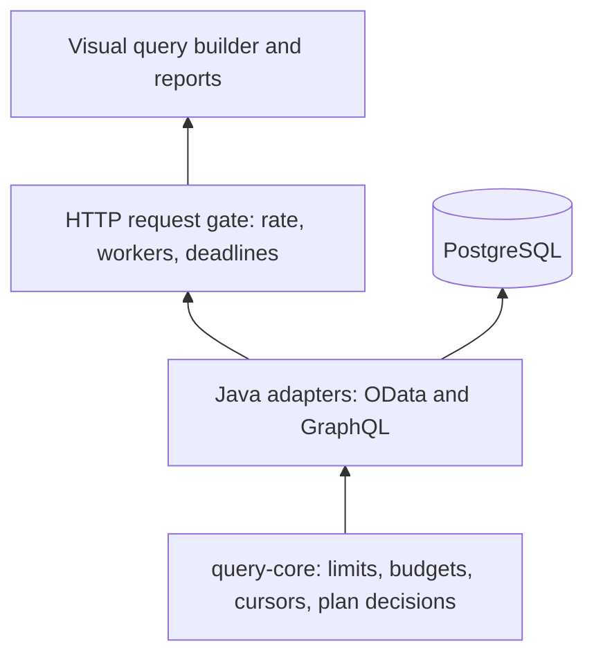

# Movie Query Lab: Architecture, Usage, and Configuration

This guide explains how to use and configure the running Movie Query POC. For code-level details, read the [developer implementation guide](developer-implementation-guide.md).

## 1. What the application does

Movie Query Lab lets you query the same PostgreSQL movie data through OData V4 and GraphQL, using a visual query builder. It demonstrates how to put limits around query shape, result volume, execution time, request traffic, and estimated database work.

The user interface builds requests; the server enforces the rules. Editing a request in the preview does not bypass safeguards. The application is a read-only demonstration: it does not expose movie creation or updates.

The database starts with five directors, ten familiar movies, and 100,000 synthetic movies. The synthetic data makes planner decisions visible without needing an external dataset. There are indexes for genre, release year, rating, and director, with movie ID used in ordering. Title deliberately has no index, making title searches useful for rejection demonstrations.

## 2. Start and choose a Java runtime

Run these commands from the repository directory. Docker Compose works with OrbStack on the Mac; Docker must be running.

```bash
cd /Users/davutgurbuz/Documents/Codex/movie-query-poc
docker compose --profile variants up -d --build --wait
```

| Runtime | Module / Compose service | Browser URL |
|---|---|---|
| Java 8 | `app-java8` / `app-java8` | http://localhost:8082/ |
| Java 17 | `app-java17` / `app` | http://localhost:8080/ |
| Java 21 | `app-java21` / `app-java21` | http://localhost:8081/ |

All three use the same database, core rules, schema, and UI. The UI reports the actual runtime version. Java 8 has its own compatibility adapter; Java 21 compiles the modern adapter sources for Java 21.

For Java 17 alone:

```bash
docker compose up -d --build --wait
```

For a foreground Java 17 process on the Mac, use `bash scripts/run-mac.sh`. It selects an installed JDK 17 unless `JAVA_HOME` is supplied, starts PostgreSQL, builds and verifies the application, then launches the JAR. It stops the Compose `app` service to free port 8080. Pressing Ctrl-C ends that foreground application; the database remains running.

`docker compose down` stops the Compose deployment while preserving its named database volume. The initial build compiles vendored SAP sources and downloads Maven dependencies. See [Java versions](java-versions.md) for build and verification details.

## 3. Use the query builder

1. Open the URL for the runtime you want to test.
2. Choose OData or GraphQL.
3. Set the total result budget, ordering, filters, and whether to include the director or count.
4. Choose an index policy mode.
5. Review the generated request, optionally edit it, and run it.
6. Inspect rows, response details, policy information, and the database plan report. Use the next-page action to follow the server continuation.

The builder offers simple comparison filters rather than a full expression editor. Advanced requests can be entered in the preview or sent directly to the API. OData property names are case-sensitive and start with uppercase letters; GraphQL fields start with lowercase letters.

The presets make the safeguards easy to observe:

| Preset | Purpose |
|---|---|
| Selective index | Query `RareGenre` with `ENFORCE`; the selective data is suitable for an indexed plan. |
| Unindexed title | Query a title with `ENFORCE`; a scan of the large movie table can be rejected. |
| Over limit | Request 501 results; the default maximum of 500 rejects it before normal execution. |

A permitted title filter and a permitted title sort are different things. Title equality is allowed as a filter. Title ordering is excluded from the ordering allow-list, even though the GraphQL enum/UI can express it.

## 4. Call the APIs directly

The examples below use Java 17. Change the port for Java 8 or Java 21.

### OData

```bash
curl --get 'http://localhost:8080/odata/Movies' \
  -H 'X-Index-Policy: ENFORCE' \
  --data-urlencode "\$filter=Genre eq 'RareGenre'" \
  --data-urlencode '$orderby=Id asc' \
  --data-urlencode '$top=10' \
  --data-urlencode '$select=Id,Title,Genre' \
  --data-urlencode '$expand=Director($select=Name)'
```

Useful routes include `/odata/Movies`, `/odata/Movies(1)`, `/odata/Movies/$count`, and `/odata/$metadata`. The service document is available at `/odata` or `/odata/`. Metadata and service-document requests do not accept query options.

Movie scalar properties are `Id`, `Title`, `Year`, `Rating`, and `Genre`; `Director` is the exposed singular relationship. Filters support comparisons `eq`, `ne`, `gt`, `ge`, `lt`, and `le`, combined with `and`, `or`, and parentheses. Functions, lambda expressions, navigation filters, batch operations, and `$apply` are outside the allowed surface. Only the supported query options are accepted.

### GraphQL

```bash
curl 'http://localhost:8080/graphql' \
  -H 'Content-Type: application/json' \
  -H 'X-Index-Policy: ENFORCE' \
  --data-binary '{"query":"query { movies(first: 10, filter: {genre: \"RareGenre\"}, orderBy: ID) { nodes { id title genre director { name } } pageInfo { hasNextPage endCursor } } }"}'
```

The JSON envelope supports `query`, `variables`, and `operationName`. Movie filters include ID, genre, title, exact year/rating, year ranges, and rating ranges. Non-null filters combine with AND; empty strings are rejected rather than silently omitted. Orders accepted by policy are `ID`, `YEAR`, `RATING`, and `GENRE`. Request `totalCount` only when you need it: it executes another guarded SQL query.

The custom `/graphql` endpoint is the public entry point. Introspection is disabled. The configured internal Spring GraphQL route is blocked by the request gate; use the supplied query UI and schema/examples rather than relying on that route.

See [OData examples](queries.http) and [GraphQL examples](graphql-examples.graphql).

## 5. Understand result budgets and continuation

`$top` and `first` are a **total result budget**, not a request to increase the server page size. With defaults, a budget of 75 produces at most 50 rows followed by at most 25. An omitted budget defaults to 100. A budget of zero is valid and returns no movie rows, although count work can still occur.

For OData, follow the returned `@odata.nextLink` exactly. Do not add a new filter, order, or larger budget. Its opaque token identifies saved paging state in the application process. Java 8 may return a quoted token in the link; preserve the link as provided.

For GraphQL, read `pageInfo.endCursor` and submit it as `after`, with the same filter, order, and direction. You can keep `first: 75` in the example above: the cursor limits the remaining budget to 25. A smaller `first` can reduce the continuation budget; a larger value cannot enlarge it.

Ordering is deterministic because ID is added as a tie-breaker when needed. Pagination uses offsets, so concurrent changes to data can shift page boundaries. It does not provide a snapshot of the original result set.

| Continuation | State and lifetime |
|---|---|
| OData | Process-local saved query state, maximum 1,000 entries, fixed five-minute token lifetime. Restart or eviction invalidates tokens. |
| GraphQL | HMAC-signed cursor containing offset, remaining budget, query fingerprint, and expiry. Default five-minute lifetime; a fresh random signing key is generated on startup unless configured. |

A stable GraphQL signing key allows compatible instances/restarts to validate cursors. It does not make OData tokens, request reports, or rate limits shared between instances. Both protocols issue fresh expiry times when creating subsequent continuation tokens.

## 6. Choose an index policy

There are two separate decisions: whether the requested query shape is allowed, and whether its estimated SQL plan is acceptable. Index mode changes the second decision only.

| Mode | Behavior |
|---|---|
| `OFF` | Skip SQL plan inspection. Other safeguards remain active. |
| `AUDIT` | Inspect and report plans, but permit execution even when the plan fails policy. |
| `ENFORCE` | Prevent the original SQL from running when the plan fails policy or cannot be verified. |

The inspector runs `EXPLAIN (FORMAT JSON, VERBOSE TRUE)` with the original prepared-statement parameters. It does not run `EXPLAIN ANALYZE`. It checks estimated total plan cost and scans throughout the plan tree, including joins. A sequential scan on a table estimated to contain at least 10,000 rows is rejected by default; small-table scans can pass. Unknown table statistics or unavailable plans fail closed in `ENFORCE`.

An index appearing anywhere in a plan is not sufficient for acceptance. Another branch may scan a large table, or total cost may be too high. Estimates depend on data, PostgreSQL statistics, and planner behavior. Cost units are planner estimates, not elapsed milliseconds.

**Counts are checked too.** GraphQL `totalCount` adds a query. OData's paging provider obtains a count even when the response does not request `$count=true`. Consequently a broad OData request can be rejected on its count plan despite a small row budget. Removing count from the UI does not eliminate OData's internal paging count.

With default client selection enabled, send `X-Index-Policy: OFF`, `AUDIT`, or `ENFORCE`. For a centrally enforced configuration, set `INDEX_POLICY_MODE=ENFORCE` and `INDEX_POLICY_CLIENT_SELECTION=false`. Clients can then request only the configured mode, not downgrade it.

## 7. Configure the application

Configuration is bound and validated at startup. Restart/recreate applications after changes. Defaults are in `app-java17/src/main/resources/application.yml` and the Java 8 equivalent.

| Property | Default | Environment setting |
|---|---:|---|
| Database URL | Local PostgreSQL, `prepareThreshold=0` | `DB_URL` |
| Database user/password | `movies` / `movies_dev_only` | `DB_USER`, `DB_PASSWORD` |
| HTTP port | 8080 inside container | `PORT` |
| `poc.default-top` | 100 | `POC_DEFAULTTOP` |
| `poc.max-top` | 500 | `MAX_TOP` |
| `poc.page-size` | 50 | `POC_PAGESIZE` |
| `poc.max-offset` | 10000 | `POC_MAXOFFSET` |
| `poc.max-expand-depth` | 2 | `POC_MAXEXPANDDEPTH` |
| `poc.max-query-complexity` | 2000 | `POC_MAXQUERYCOMPLEXITY` |
| `poc.request-timeout-ms` | 5000 | `POC_REQUESTTIMEOUTMS` |
| `poc.db-timeout-ms` | 3000 | `POC_DBTIMEOUTMS` |
| `poc.rate-per-minute` | 60 | `POC_RATEPERMINUTE` |
| `poc.max-concurrent-requests` | 8 | `POC_MAXCONCURRENTREQUESTS` |
| `poc.index-policy.mode` | `OFF` | `INDEX_POLICY_MODE` |
| `poc.index-policy.allow-client-selection` | true | `INDEX_POLICY_CLIENT_SELECTION` |
| `poc.index-policy.min-table-rows` | 10000 | `INDEX_POLICY_MIN_ROWS` |
| `poc.index-policy.max-plan-cost` | 100000 | `INDEX_POLICY_MAX_COST` |
| GraphQL cursor signing key | Random on startup | `CURSOR_SECRET_BASE64` |
| GraphQL cursor lifetime | 300000 ms | `CURSOR_TTL_MS` |

The explicit short environment names come from YAML placeholders; the `POC_*` names use Spring's environment-property binding (replace dots with underscores, remove hyphens, and uppercase). A local JAR also accepts arguments such as `--poc.page-size=25`.

Maximum top cannot exceed 1,000. Default top must be between zero and maximum top; page size must be between one and maximum top. Offset/depth limits must be nonnegative, and complexity, timeout, rate, and concurrency values must be positive. Index thresholds must be nonnegative, with finite cost. Signing keys must decode from Base64 to at least 32 bytes; cursor lifetime must be positive. Invalid settings prevent startup rather than silently removing safeguards.

To generate a stable key:

```bash
openssl rand -base64 32
```

Pass the result through configuration. `CURSOR_TTL_MS` affects GraphQL only; OData currently has a fixed lifetime. Field allow-lists and body/filter syntax limits are defined in code, not configurable YAML lists.

### Docker configuration example

A host environment variable or Compose `.env` entry is not automatically injected into these application containers. Add the settings to service `environment` entries. For example, save this as `compose.policy.yml` in the repository:

```yaml
services:
  app:
    environment: &query-policy
      INDEX_POLICY_MODE: ENFORCE
      INDEX_POLICY_CLIENT_SELECTION: "false"
      POC_PAGESIZE: "25"
  app-java8:
    environment: *query-policy
  app-java21:
    environment: *query-policy
```

Apply it with:

```bash
docker compose -f compose.yml -f compose.policy.yml --profile variants up -d --force-recreate --wait
```

The override merges with the existing database environment entries. Each container still listens on port 8080 internally; the base Compose file maps different host ports. Avoid changing `PORT` without updating mappings and health checks.

## 8. Inspect limits, reports, and failures

`GET /api/capabilities` reports limits, allow-lists, policy settings, and runtime information. The UI uses it to show current settings and disable client mode selection when prohibited.

Gated requests normally receive `X-Request-Id`. Retrieve their report with `GET /api/requests/{id}`. GraphQL also includes request and index-policy information in `extensions`. Reports contain plan costs, scan descriptions, acceptance decisions, and reasons; they do not contain SQL text or bound values. Only the most recent 200 reports are kept in each process. Early request rejections may not have a saved report.

| Symptom | Meaning / next step |
|---|---|
| 422 policy rejection | Check the error code, requested budget, allowed fields, cursor, and plan reasons. |
| 403 mode rejection | Client policy selection is restricted by server configuration. |
| 405 | Use GET for OData and POST for GraphQL. |
| 413 | Request body or URL query is too large. |
| 429 with `Retry-After` | The per-client-address rate window is exhausted. |
| 503 | All query workers are occupied, or processing was interrupted. |
| 504 | The request worker exceeded the configured processing timeout. |
| GraphQL HTTP 200 with `errors` | Inspect the GraphQL error array; HTTP success does not guarantee query success. |
| Expired/unknown continuation | Start a new query; OData can return a protocol-specific error such as 410. |

Database statement timeout and request timeout are separate. The JDBC layer reduces statement time to the smaller of the database limit and remaining request time. Worker cancellation is best effort; the database timeout provides an additional bound.

## 9. Architecture from core to UI



The diagram shows layers of responsibility, not dependency imports: adapters depend on the core, while the core has no framework dependencies. OData uses SAP/Olingo and EclipseLink. GraphQL uses Spring Data repositories, Querydsl predicates and EclipseLink. Both reuse the JPA entity model and pass ORM-generated SQL through the same guarded JDBC boundary.

The GraphQL connection adapter handles limits, signed cursors and paging once for reuse across entities. Movie-specific repository bindings define permitted filters and ranges. The schema remains explicit; this integration does not automatically expose every entity or property. The previous handwritten SQL approach is preserved on Git branch `archive/jdbc-template` at commit `401fd16`.

GraphQL aliases, fragments and conditional selections affect the response normally. The ORM eagerly joins the singular director even when it is not selected, avoiding per-movie lookups at the cost of fetching that related data. A zero result budget skips the movie SELECT; requesting `totalCount` still performs a count. Existing cursor tokens must be restarted after the migration because the query fingerprint format changed.

The query gate covers the OData and GraphQL routes. Static UI and capabilities/report routes are separate. Authentication, tenant authorization, distributed rate limiting, and shared OData paging storage are not implemented in this POC. Its local deployment binds published ports to localhost.

For validation, `bash scripts/verify-matrix.sh` runs core, unit, and PostgreSQL integration checks on actual JDK 8, 17, and 21 containers. `python3 scripts/smoke-matrix.py` checks the three running services, including selective/rejected plans and 75-result pagination. Recorded results are documented in [Java versions](java-versions.md).

For protocol selection and BFF tradeoffs, see [Choosing OData or GraphQL](choosing-odata-or-graphql.md). The [presentation](movie-query-poc-presentation.pptx) is a historical snapshot of the JDBC implementation; these guides describe the current Querydsl/JPA implementation.
