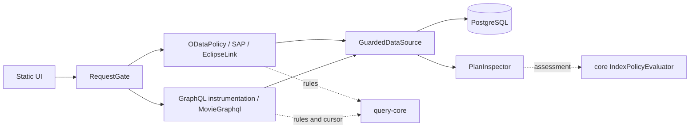
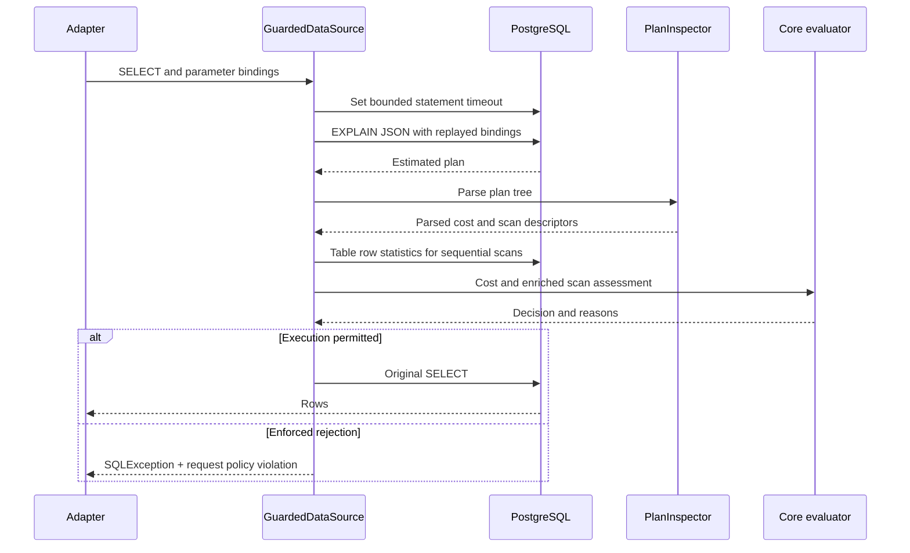

# Movie Query Lab: Developer Implementation Guide

This guide follows the implementation from the framework-free query core to protocol adapters, database execution, HTTP protection, and UI. The [architecture and user guide](architecture-and-user-guide.md) covers running the application and changing its settings.

## 1. Module boundaries

| Module | Responsibility |
|---|---|
| `query-core` | Immutable limits, field permissions, paging arithmetic, signed cursor contract, and estimated-plan decisions. Targets Java 8 and has no Spring, JPA, GraphQL, JSON, or JDBC dependencies. |
| `app-java8` | Boot 2.7 / javax / EclipseLink 2.7 / SAP 1.1.1 compatibility adapter, with Java 8 syntax and its own classes. |
| `app-java17` | Boot 3.5 / Jakarta / EclipseLink 4 / SAP 2.5 modern adapter and shared frontend/schema/seed resources. |
| `app-java21` | Separate Java 21 artifact, compiling the Java 17 source and test trees for Java 21. |

The root reactor includes core and Java 17 by default. Profiles add Java 8 or Java 21. The Java 8 module has its own Boot parent. Vendored SAP trees under `vendor/sap` and `vendor/sap-java8` provide the appropriate unpublished dependencies; bootstrap scripts build them into the Maven repository.



There is no universal query AST or shared query compiler. Protocol parsing stays in adapters. The core evaluates normalized inputs supplied by those adapters. Similarly, the core plan evaluator decides from a small assessment structure; it does not inspect SQL or PostgreSQL JSON itself.

## 2. Core limits and semantic policy

Source: [Limits](../query-core/src/main/java/dev/poc/core/Limits.java), [QueryPolicy](../query-core/src/main/java/dev/poc/core/QueryPolicy.java), and [PolicyException](../query-core/src/main/java/dev/poc/core/PolicyException.java).

### Limits

`Limits` is an immutable Java 8 class containing result, offset, depth, complexity, timeout, rate, concurrency, and index-policy settings. Its constructor validates configuration. The nested `IndexPolicy` carries mode, client-selection permission, large-table threshold, and maximum estimated cost. Runtime adapters expose their own Spring-bound `Limits` types and convert them with `core()`; core configuration does not depend on Spring binding.

`top(Integer)` resolves null to the default and accepts the inclusive interval zero through `maxTop`. `offset(Integer)` resolves null to zero and accepts zero through `maxOffset`. Violations throw `PolicyException` with `TOP_LIMIT` or `OFFSET_LIMIT`. Configuration validation also caps `maxTop` at 1,000, checks page/default-top relationships, and rejects invalid limits.

The core supplies accessors for direct use and bean-style consumers. Values cannot be mutated after construction. Adapters should construct valid limits rather than treating a negative value as an unlimited sentinel.

### QueryPolicy

`QueryPolicy` owns the limits and defensive, unmodifiable copies of filter and order field sets. It validates field entries and applies case-sensitive membership checks. [CoreConfig](../app-java17/src/main/java/dev/poc/CoreConfig.java) fixes the current public names:

- Filter: `Id`, `Title`, `Year`, `Rating`, `Genre`.
- Order: `Id`, `Year`, `Rating`, `Genre`.

Protocol adapters map their inputs to these names. `filterField` and `orderField` produce `FILTER_FIELD` and `ORDER_FIELD`. `budget(depth, complexity)` accepts nonnegative values through the configured ceilings and otherwise produces `EXPAND_DEPTH` or `QUERY_COMPLEXITY`. Complexity is a `long`, avoiding narrow intermediate arithmetic in core checks.

`indexMode(requested)` resolves an absent header to the configured mode. Explicit values are uppercased with `Locale.ROOT`; whitespace is not trimmed. Invalid modes produce `INDEX_MODE`. When client selection is disabled, requesting the configured mode is allowed, but requesting another mode is denied by the HTTP adapter with 403.

These checks do not parse strings, load entities, or execute SQL. The correctness of normalization and cost estimation belongs to the calling adapter.

### Page: the budget state transition

`QueryPolicy.Page` carries `offset`, `size`, remaining `budget`, and `maxOffset`. `page(top, offset, preferredSize)` validates budget/offset and calculates:

```text
size = min(budget, configured page size, positive preferred size if supplied)
remaining(returned) = budget - returned
next offset = offset + returned, only if a full nonzero page leaves budget
```

Returned rows must be between zero and page size. A short page, zero-size page, or exhausted budget terminates paging. Offset addition uses wider arithmetic and rejects a continuation exceeding `maxOffset`, rather than wrapping.

For a 75-row budget and page size 50, the first page leaves 25; the second exhausts it. This abstraction does not know whether more database rows exist. GraphQL supplies that information using lookahead; OData uses its paging count.

## 3. Signed GraphQL cursor data

Source: [CursorCodec](../query-core/src/main/java/dev/poc/core/CursorCodec.java).

A cursor is a URL-safe Base64 payload plus a signature, separated by a period. The decoded payload is:

```text
offset:remaining:fingerprint:expires
```

The fingerprint is a lowercase hexadecimal SHA-256 digest. Expiry is an epoch-millisecond timestamp. The signature is HMAC-SHA256 over the encoded payload, using a cloned secret of at least 32 bytes. Base64 encoding omits padding. The payload is readable; signing supplies integrity rather than encryption.

Encoding checks nonnegative offset/budget and fingerprint shape, then computes expiry using the injected clock and TTL. Decoding bounds token length to 512 characters, checks the two-part form and signature with constant-time comparison, parses four fields, rejects expired/negative values, and compares the expected fingerprint. Invalid input becomes `CURSOR_INVALID` without exposing cryptographic details. The adapter revalidates decoded offsets and remaining budget against configured limits.

`CoreConfig` decodes `CURSOR_SECRET_BASE64`, or creates a random 32-byte startup key. The default TTL is five minutes. An injected `Clock` makes cursor tests deterministic.

The current GraphQL fingerprint combines the generated WHERE fragment, parameter-list representation, mapped order column, and direction. It binds the current filter/order semantics, not the entire GraphQL document: selection fields and `first` are not included. Remaining budget is independently enforced. The format is adapter-specific, not a general canonical AST representation or an authorization token.

## 4. Estimated plan evaluator

Source: [IndexPolicyEvaluator](../query-core/src/main/java/dev/poc/core/IndexPolicyEvaluator.java).

The adapter supplies whether a plan is available, its estimated total cost, and a list of `Scan` values. Each scan has its type, relation identity, and estimated table rows. A `Decision` returns an execution permission and immutable reasons. The evaluator has no JDBC or JSON dependencies.

The decision rules are:

1. Validate policy mode and thresholds.
2. In `OFF`, permit execution without needing a plan.
3. In other modes, mark unavailable/malformed assessments as a failure.
4. Reject total cost strictly greater than the maximum; equality is accepted.
5. For `Seq Scan` and `Parallel Seq Scan`, reject unknown/invalid row estimates or estimates greater than or equal to the large-table threshold.
6. Permit execution in `AUDIT` regardless of reasons; in `ENFORCE`, permit only when there are no reasons.

Non-sequential scan types do not independently require an index. A valid, inexpensive plan with no scan nodes can pass. An index in one branch does not cancel a rejected sequential scan elsewhere.

The report's `accepted` flag means that there are no policy reasons. It is different from execution permission: an audited query with `accepted: false` still runs.

## 5. OData normalization and execution

Sources: [ODataPolicy](../app-java17/src/main/java/dev/poc/ODataPolicy.java), [ODataController](../app-java17/src/main/java/dev/poc/ODataController.java), [JpaConfig](../app-java17/src/main/java/dev/poc/JpaConfig.java), and [ODataPaging](../app-java17/src/main/java/dev/poc/ODataPaging.java).

### Restricted public syntax

`ODataPolicy` examines allowed paths and query parameters before SAP processing. Supported options include `$top`, `$skip`, `$filter`, `$orderby`, `$select`, `$expand`, `$count`, `$skiptoken`, and `$format`. Unknown or repeated options are rejected. Service and metadata routes must have no options; a continuation uses its skiptoken alone.

Its filter preprocessor tokenizes identifiers, quoted strings with doubled-quote escaping, numeric literals, comparisons, Boolean operators, and parentheses. It fully consumes its restricted grammar and checks fields/types. Limits include 4,096 filter characters, 120 tokens, and eight nested filter parentheses. String literals are required for Title/Genre comparisons; numeric fields accept numeric literals. This prevents arbitrary functions or navigation expressions from reaching the public query surface.

Select permits the five movie scalar properties. Expand permits the singular `Director`, optionally with its `Id`/`Name` selection. Ordering checks allowed fields, direction, and duplicates, then adds ID ordering when needed.

OData's estimated complexity is:

```text
5 × filter token count
+ 5 × requested order-field count
+ 50 when expanded
+ min(top, pageSize) × (12 when expanded, otherwise 6)
```

Expansion depth is counted conservatively from syntax: plain `Director` has depth one, while `Director($select=...)` has depth two. It is not a recursive entity-path counter. The model exposes no reverse director-to-movies collection.

After validation, a normalized request wrapper supplies query text and parameters. SAP/Olingo performs actual OData parsing, semantic processing, and SQL generation through EclipseLink. The preprocessor is not a replacement OData implementation.

### Entity and paging interaction

`ODataController` creates an entity manager per request and passes it into SAP's request handler. `JpaConfig` uses the guarded data source, scans model entities, disables weaving and shared caching, and registers the paging provider. Movie's foreign-key backing field is hidden from OData; the relationship exposes Director.

For a first page, `ODataPaging` asks SAP's count query for the total. It computes the available budget from top and total-minus-skip, and caps page size through core policy. Count SQL therefore passes through index inspection even without a count in the response.

Continuation state is a synchronized, insertion-ordered map of opaque UUID tokens to saved `JPAODataPage`, remaining budget, and expiry. It has 1,000 entries, expires tokens after five minutes, and evicts old entries when full. Saved URI information binds the continuation to the original query. Following a token produces the next saved page and a new token if budget/data remain. Tokens are replayable until expiry or eviction; fetching does not consume them.

Unlike GraphQL, OData continuation is process-local and its TTL is fixed in code. Java 8 supports SAP 1.1.1's quoted UUID links and nullable paging API; modern SAP uses its newer return contracts. The Java 8 entities also use public constructors required by that older metadata reflection path.

## 6. GraphQL evaluation and SQL construction

Sources: [schema](../app-java17/src/main/resources/graphql/schema.graphqls), [GraphqlConfig](../app-java17/src/main/java/dev/poc/GraphqlConfig.java), [GraphqlHttpController](../app-java17/src/main/java/dev/poc/GraphqlHttpController.java), and [MovieGraphql](../app-java17/src/main/java/dev/poc/MovieGraphql.java).

### Document limits

The custom controller accepts query text, variables, and optional operation name. It rejects absent or over-8,192-character query text, builds `ExecutionInput`, and attaches `RequestState` to GraphQL context. It executes synchronously and adds request/index-policy extensions to the result specification.

Instrumentation disables introspection and bounds structural depth to `maxExpandDepth + 4`, allowing for connection/node wrappers. Complexity is evaluated from the GraphQL document, including aliases and fragments. Fields contribute `1 + childComplexity`; the movies field weights that subtree by the bounded first-page size and adds fixed overhead. Argument values, including variables, are used to validate top. Core budget validation and the library's aggregate maximum-complexity instrumentation constrain the result.

GraphQL structural depth is not the same measurement as OData expand syntax. In particular, wrapper allowance means changing the core depth setting does not translate into an identical relationship-depth rule across both protocols.

### Resolver data structures

`MovieFilter` represents nullable typed filters: ID, genre, title, exact/ranged year, and exact/ranged rating. ID text is parsed as a long; invalid ID input produces `FILTER_VALUE`. Text filters are length-limited. Fixed field mappings produce SQL identifiers, and user values become JDBC parameters. Order enums are mapped to core names before constructing SQL; `TITLE` is rejected by the core order allow-list.

`ConnectionPage` contains:

| Field | Use |
|---|---|
| `nodes` | List of movie maps returned by JDBC. |
| `pageInfo` | `hasNextPage` and optional signed `endCursor`. |
| `where` | Internal SQL fragment reused by the count resolver. |
| `params` | Copied parameter list for that fragment. |

Only schema fields are exposed. Internal SQL fields are not GraphQL output fields.

The resolver builds a deterministic WHERE fragment and parameter list, validates order/top, and computes the fingerprint. If `after` is present, it decodes the cursor, validates offset, and uses the smaller of requested first and cursor remaining budget.

Lookahead SQL requests `min(remaining, pageSize + 1)` rows, or zero for an empty page. An extra row proves that another page exists; it is trimmed from output. No extra row is needed when the page exhausts the budget. ID is a tie-breaker unless ID itself is the selected order.

Movie scalar columns are fetched together. A director selection triggers a join, rather than a query for every node. `totalCount` has its own resolver using the stored WHERE/parameters and runs only when selected. Each SELECT is independently inspected by the JDBC guard.

`withState` restores the request state around resolver work using the GraphQL context, then restores/removes the previous thread-local value in `finally`. This explicit bridge ensures JDBC inspection sees the right request even when GraphQL invokes a fetcher on another thread; it is not an automatic propagation mechanism for arbitrary asynchronous work.

## 7. Shared JDBC boundary

Sources: [DataSourceConfig](../app-java17/src/main/java/dev/poc/DataSourceConfig.java), [GuardedDataSource](../app-java17/src/main/java/dev/poc/GuardedDataSource.java), and [PlanInspector](../app-java17/src/main/java/dev/poc/PlanInspector.java).

### Connection and statement wrappers

`DataSourceConfig` creates a Hikari pool sized to `maxConcurrentRequests`, with a two-second connection acquisition timeout and configured PostgreSQL statement timeout, then wraps it. Both JPA and `JdbcTemplate` receive the wrapper.

JDK proxies wrap connections and statements. Preparing/creating statements updates the connection timeout budget. Prepared-statement setter calls are recorded in an index-ordered map of `Binding(method, cloned arguments)`; `clearParameters` clears that state. The guard replays the same setters onto the EXPLAIN statement. It does not interpolate values into SQL. Stream/reader parameter replay is rejected as unavailable rather than consuming the input. Argument arrays are cloned; mutable objects are not deeply copied.

Inspection covers `executeQuery`, `execute`, and `executeUpdate` when SQL begins with `SELECT`, ignoring leading whitespace and case. This is the generated SQL surface of the POC, not a complete interceptor for arbitrary SQL forms such as leading CTEs or batches. Extending query execution to those forms requires extending interception and tests.

Inspection is skipped when no gated request state exists or mode is `OFF`. Startup migration SQL therefore does not undergo request index policy. Connection-level timeouts still apply.

### Inspect, decide, execute



`PlanInspector` expects one JSON plan root with numeric `Total Cost`. It recursively traverses `Plans`, collecting scan nodes and their type, schema, relation, and index name. For sequential scans, `GuardedDataSource` enriches these descriptors by reading `pg_class.reltuples` through a schema-qualified statistics lookup; unavailable statistics become an unknown estimate. Index names belong to reporting, not the core acceptance algorithm.

EXPLAIN, statistics queries, and timeout updates use the underlying connection directly, avoiding recursive interception. EXPLAIN uses JSON and VERBOSE, without ANALYZE. The guard translates the assessment into core scans, records the report, and asks the evaluator whether execution is permitted.

On enforced policy rejection it sets the request's `INDEX_POLICY` violation and raises SQLSTATE `42501` before invoking the original statement. Inspection/parse/statistics failure records an unavailable-plan reason; `ENFORCE` sets `INDEX_PLAN_UNAVAILABLE`, while `AUDIT` permits the original query to proceed. The timeout budget is updated again before executing permitted SQL.

The PostgreSQL URL uses `prepareThreshold=0` to reduce generic server-prepared-plan differences. Nevertheless EXPLAIN is an estimate, not proof of the eventual executed plan or latency. Statistics/session settings/schema changes can alter behavior.

## 8. HTTP request lifecycle and state

Sources: [RequestGate](../app-java17/src/main/java/dev/poc/RequestGate.java), [RequestState](../app-java17/src/main/java/dev/poc/RequestState.java), [Errors](../app-java17/src/main/java/dev/poc/Errors.java), and [CapabilitiesController](../app-java17/src/main/java/dev/poc/CapabilitiesController.java).

`RequestGate` applies to OData paths, `/graphql`, and the blocked internal GraphQL path. Static UI, capabilities, and report endpoints do not use this query worker/rate gate.

The gate checks the internal-route prohibition, per-address rate limit, allowed method, URL query length, POST body size, and requested index mode. Limits include 8,192 URL-query characters and 32 KiB POST bodies. The rate limiter uses `getRemoteAddr()`, fixed 60-second windows starting on the address's first request, and at most 10,000 address entries. Expired windows are purged during admission; forwarded proxy headers are not used as the client key.

After admission, `RequestState` carries UUID request ID, effective mode, monotonic deadline, synchronized plan list, and a volatile policy violation. The worker installs it in a thread-local, runs the servlet chain, and removes it in `finally`.

A fixed worker pool uses `SynchronousQueue`: there is no waiting request queue. With all workers busy, admission fails with 503. Response body/status/headers are buffered until completion, allowing an enforced JDBC violation to replace a partially generated protocol response with a 422 error.

The caller waits on the worker future with the configured request timeout. Expiry cancels the future with interruption and returns 504. Interrupted processing returns 503; execution failures are translated from the root cause or recorded policy violation. The deadline covers worker processing, not all earlier body-reading or final network-writing time. Interruption is best effort and does not guarantee every blocking library call immediately stops.

At the JDBC boundary, remaining request time is compared with `dbTimeoutMs`; the smaller positive duration is applied through PostgreSQL `set_config('statement_timeout', ..., false)`. An exhausted budget raises a timeout SQL exception. This bounds individual statements as the request progresses.

Completed/timed-out reports are copied into a process-local insertion-ordered store of the latest 200 requests. Reports include request ID, mode, costs, scans, accepted flags, and reasons. SQL and parameter values are omitted. Early rejections and worker-admission failures need not have a stored trace.

Error transport depends on the layer. Gate failures use HTTP status codes such as 422, 429, 503, or 504. SAP may produce its own OData envelope/status. GraphQL validation/resolver errors can be returned in `errors` with HTTP 200. Modern exception handling uses a GraphQL exception handler; Java 8 uses a `DataFetcherExceptionResolverAdapter`. Consumers must inspect both status and protocol body.

## 9. Data and presentation layers

The [migration](../app-java17/src/main/resources/db/migration/V1__movies.sql) creates directors and movies, seeds deterministic synthetic values, creates indexes, and analyzes both tables. Movie IDs are primary keys; `director_id` is a foreign key. Indexes combine genre/year/rating/director with ID. There is deliberately no title index.

The [static resource directory](../app-java17/src/main/resources/static/) contains the HTML/CSS/JavaScript query builder. It is served by Spring, without a separate frontend build. It reads `/api/capabilities`, builds protocol requests, sends the selected policy header, renders response data, and obtains reports using request IDs. Continuation uses server links/cursors. Backend policy is authoritative regardless of preview edits.

Java 8 shares these UI/schema/migration resources while retaining its own application configuration. Java 21 shares modern sources, tests, and resources; new changes there must remain compilable on Java 17. Java 8 adapter changes require a corresponding compatibility implementation where relevant.

## 10. Extension and verification guidance

When adding a field, update the database/model and schema, protocol normalization/mapping, core allow-lists, UI options, and parameterized SQL as appropriate. Decide filtering and ordering separately. When adding relationships, revisit expand grammar, structural depth, complexity estimates, SQL joins, and count behavior. Adding an enum entry alone does not grant permission.

New asynchronous work must carry request state explicitly. New SQL execution styles must stay inside the guarded data source and have interception coverage. New public routes require an explicit decision about request gating. A multi-instance deployment would require shared OData continuation/rate/report stores if consistent cross-instance behavior is needed; a shared GraphQL signing key only solves cursor verification.

Verification layers serve different purposes:

| Layer | What it establishes |
|---|---|
| Framework-free core checks | Boundary arithmetic, immutable decisions, field policy, cursor integrity/query binding, and plan rules. |
| Adapter unit tests | Protocol grammar/complexity, JDBC binding replay, blocked execution, deadlines, concurrency, and compatibility behavior. |
| PostgreSQL integration tests | Real SAP metadata/query handling, GraphQL requests, paging/counts, and planner decisions. |
| Live smoke matrix | All deployed runtimes respond, selected plans pass, unindexed scans fail, and 75 results page as 50 + 25. |

```bash
bash scripts/verify-matrix.sh
python3 scripts/smoke-matrix.py
```

The matrix script runs builds sequentially on actual JDK 8, 17, and 21 containers because the reactors share `query-core/target`. It starts PostgreSQL and runs integration verification. The smoke script requires the three applications to be running. Recorded validation and exact runtime/build details are in [Java versions](java-versions.md) and [test summary](java-version-test-summary.json).

The `RUNNING1` tag preserves the original running Java 17 baseline; later module work is separate. Historical reports describe their recorded snapshots, while the source links in this guide describe the current implementation.
